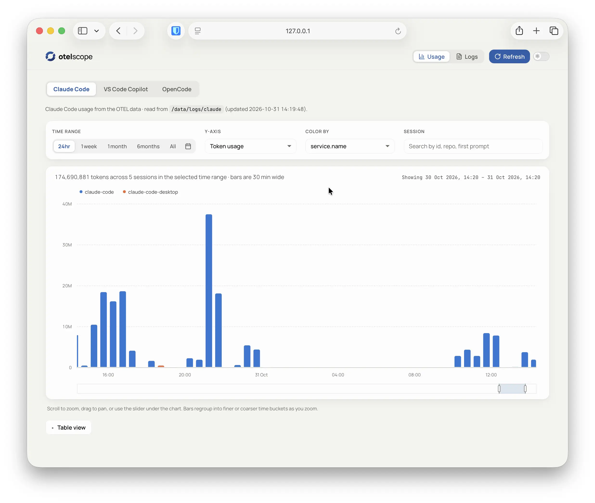
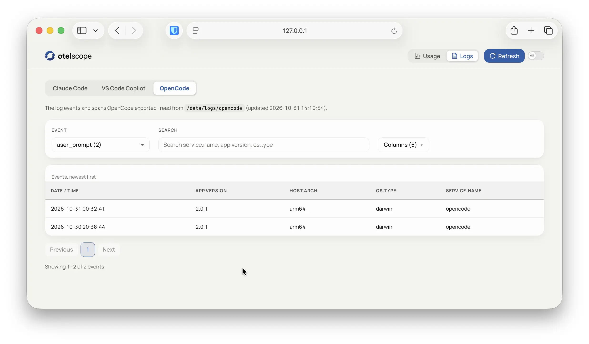

# otelscope <span></span>





A Docker setup that records the OpenTelemetry (OTEL) output of harnesses such as Claude Code, VS Code Copilot chat and OpenCode into protobuf log files in your home directory, one folder per tool. A second optional container runs a small website with a tab for each tool, explores the data. The first container is the **logger** that writes the files and a **site** container that only reads them. They can be run independently or together.

```
Claude Code ──▶─┐   OTLP/HTTP, protobuf
VS Code     ──▶─┼──▶ logger container ──▶ ~/otelscope/<tool>/{metrics,logs,traces}.pblog
OpenCode    ──▶─┘

~/otelscope ──▶ site (a second container, read-only) ──▶ 127.0.0.1:5174
```

## Usage

The log folder must exist before the first start.

```bash
mkdir -p ~/otelscope # a fresh start
```

Then:

```bash
# Build and run both containers in one step
docker compose up -d --build
```

`docker-compose.yml` builds and starts the **logger** and the **site**. The ports are published on `127.0.0.1` only: inside the container the servers listen everywhere, so never publish them more widely. A mount whose folder doesn't exist is an error, not a new empty folder.

```bash
# Build and run only the logger
docker compose -f docker-compose.logger.yml up -d --build
# Build and run only the site
docker compose -f docker-compose.site.yml up -d --build
# stop or start again
docker compose stop
docker compose start
# Remove the containers
docker compose down
```

## How it works

`otel-logger.py` listens on **several ports at once, and the port decides which tool a request belongs to** (see *Choosing the ports, protocols and folders*). Each request is appended, as protobuf, to `~/otelscope/<tool>/{metrics,logs,traces}.pblog`.

**The Claude Code guard.** The `claude` port keeps a request only if its `service.name` is `claude-code` or `claude-code-desktop`; anything else sent there goes to `~/otelscope/other/`. Claude Code data that arrives on another tool's port is moved to `~/otelscope/claude/`. So neither mixes into the other's files, which can't be cleaned afterward.

**The files.** A `.pblog` file is a series of records, each appended in one write: a marker, a length, a CRC32 and a small protobuf `Record` with the receive time and **the OTLP request exactly as the tool sent it** (JSON is converted to protobuf once, on arrival, so set every tool to protobuf, see *Tool settings*). Details are in `otel-record.proto`. Files are only opened for appending (or, by `convert`, created new): nothing deletes, truncates or rewrites them, and a test enforces that. The logger never prints request content.

**Two images.** `Dockerfile.logger` (Python, the protobuf libraries, `otel-logger.py`) **writes** the logs. `Dockerfile.site` (Node, VitePress, and Python only to read the `.pblog` files) serves the website and **reads** them. Neither image holds a port: `docker-compose.yml` gives them at start. Your log folder is mounted into both (read-only for the site), so the files stay on your system, and the logger refuses to start if it isn't on a mounted folder. The site can be down without the logger noticing.

## Forwarding data to another receiver

Data can be forwarded to another OTLP/HTTP receiver by setting the `OTEL_LOGGER_FORWARD_URL` environment variable. The logger will send every received request to that URL as protobuf, in addition to writing it to the local log files.
An example using otelview:

```
# website on 4319
# listening to otel on 4318 (http), 4317 (gRPC)
# data is stored in ~/otelview

docker run -d \
  --name otelview \
  --restart unless-stopped \
  -p 127.0.0.1:5080:4318 \
  -p 127.0.0.1:4319:4319 \
  -v ~/otelview:/data \
  ghcr.io/tsirysndr/otelview \
  --listen 0.0.0.0:4319 \
  --storage duckdb
```

`docker-compose.yml` sets `OTEL_LOGGER_FORWARD_URL` to `http://host.docker.internal:5080`: inside the container `127.0.0.1` is the container itself, so your system is `host.docker.internal`, and the logger adds `/v1/<signal>`. Set `OTEL_LOGGER_FORWARD_URL=` (empty) in the git-ignored `.env` to turn the copy off; `OTEL_LOGGER_FORWARD_HEADERS` (`name=value,name=value`) adds headers for a receiver that needs a login. The copy runs in the background with a bounded queue and retries, so it never slows the logging. If nothing answers, the logger prints `forward: cannot reach the receiver …` (at most once a minute, see `docker compose logs logger`) and drops that copy. It refuses to start if the URL is one of its own ports on this machine, because every copy would be logged and forwarded again, forever; that is also why no tool listens on 5080.

## Choosing the ports, protocols and folders

All of it is in `docker-compose.yml` and can be overridden at runtime, from a git-ignored `.env` next to it or from the shell, with no rebuild of the image (`docker compose up -d` is enough):

| Variable | Default | |
|---|---|---|
| `CLAUDE_PORT`, `VSCODE_PORT`, `OPENCODE_PORT` | `4318`, `4316`, `4317` | The port, on your system and in the container (the same number, so a tool's setting is what the logger listens on).|
| `CLAUDE_PROTOCOL`, `VSCODE_PROTOCOL`, `OPENCODE_PROTOCOL` | `any` | What the port accepts: `any`, `protobuf` or `json` (`http/protobuf` and `http/json` work too). The other format gets a `415` and is not logged, so `protobuf` makes a tool set to JSON show up as an error. gRPC is not supported. |
| `CLAUDE_DIR`, `VSCODE_DIR`, `OPENCODE_DIR` | empty: `<logs>/<tool>` | A folder of its own, as a path **inside the container** (a relative one is under `/data/logs`). If it is outside `/data/logs`, mount it too (add a `volumes` entry), or the logger refuses to start. The site only reads folders under the log folder. |
| `SITE_PORT` | `5174` | The site's port. |
| `OTEL_LOGS_DIR` | `~/otelscope` | The log folder on your system (must already exist). |
| `OTEL_LOGGER_FORWARD_URL`, `OTEL_LOGGER_FORWARD_HEADERS` | `http://host.docker.internal:5080`, empty | The copy sent on to another OTLP/HTTP receiver: an empty URL turns it off; the headers are for a receiver that needs them. |

Every port takes `POST /v1/<signal>` (`metrics`, `logs` or `traces`) and `GET /healthz`; anything in front of `/v1` is ignored, so the port decides, not the path. `docker compose exec logger entrypoint.sh listeners` shows what the logger is using, and the raw `OTEL_LOGGER_LISTEN` syntax, `NAME:PORT[:PROTOCOL[:DIR]]`, is described at the top of `otel-logger.py`.

**Adding a new tool** (say `mytool` on 4320) takes two lines in the `logger` service of `docker-compose.yml`, where the other tools are: a `ports` entry (`"127.0.0.1:${MYTOOL_PORT:-4320}:${MYTOOL_PORT:-4320}"`) and an entry in `OTEL_LOGGER_LISTEN` (`mytool:${MYTOOL_PORT:-4320}:${MYTOOL_PROTOCOL:-any}:${MYTOOL_DIR:-}`, with a comma after the entry before it), then the tool's own endpoint (section 4). Its folder, `~/otelscope/mytool/`, appears with the first request (a name is letters, digits, `-` and `_`; `other` is reserved), and its tab on the site after **Refresh**. Docker only publishes the ports a compose file lists, which is why a port is named there as well as in `OTEL_LOGGER_LISTEN`. A missing comma or a repeated port stops the logger with a message, rather than logging to a wrong place. All the logger's own settings are listed at the top of `otel-logger.py`.

## Reading the logs

`.pblog` files are binary, so `grep` and `jq` can't read them directly. `cat` (with `-T`, so Compose doesn't add a terminal to piped output) prints each record as the JSON lines the old logger wrote (`{"received_at": …, "data": …}`):

```bash
docker compose run --rm -T tools cat /data/logs/claude/logs.pblog | jq -r '.data.resourceLogs[].scopeLogs[].logRecords[].body.stringValue' | sort | uniq -c | sort -rn
```

Without Docker: `python3 otel-logger.py cat FILE | jq …` (after `pip install -r requirements.txt`). The recipes in `README-old.md` (section 4) work the same way: replace the file argument with a pipe from `cat`. `cat` skips damaged records and says how many.

## Tool settings

### Claude Code

The documentation is at [Claude Code monitoring guide](https://code.claude.com/docs/en/monitoring-usage). Update `~/.claude/settings.json` and restart Claude Code.

```json
{
  "env": {
    "CLAUDE_CODE_ENABLE_TELEMETRY": "1",
    "OTEL_METRICS_EXPORTER": "otlp",
    "OTEL_LOGS_EXPORTER": "otlp",
    "OTEL_TRACES_EXPORTER": "otlp",
    "CLAUDE_CODE_ENHANCED_TELEMETRY_BETA": "1",
    "OTEL_EXPORTER_OTLP_PROTOCOL": "http/protobuf",
    "OTEL_EXPORTER_OTLP_ENDPOINT": "http://127.0.0.1:4318",
    "OTEL_LOG_USER_PROMPTS": "1",
    "OTEL_LOG_ASSISTANT_RESPONSES": "1",
    "OTEL_LOG_TOOL_DETAILS": "1",
    "OTEL_LOG_TOOL_CONTENT": "1",
    "OTEL_METRICS_INCLUDE_VERSION": "true",
    "OTEL_METRICS_INCLUDE_ENTRYPOINT": "true",
    "OTEL_METRICS_INCLUDE_REPOSITORY": "true"
  }
}
```

### VS Code Copilot Chat

The full list of settings and signals is in VS Code's [monitoring guide](https://code.visualstudio.com/docs/agents/guides/monitoring-agents). Update user settings in `settings.json` (`~/Library/Application\ Support/Code/User/settings.json`), then *Developer: Reload Window*:

```json
"github.copilot.chat.otel.enabled": true,
"github.copilot.chat.otel.exporterType": "otlp-http",
"github.copilot.chat.otel.protocol": "http/protobuf",
"github.copilot.chat.otel.otlpEndpoint": "http://127.0.0.1:4316",
"github.copilot.chat.otel.captureContent": true,
"github.copilot.chat.otel.captureIdentity": true
```

### OpenCode

OpenCode has no built-in exporter. The community plugin `@devtheops/opencode-plugin-otel` adds this functionality. The plugin and documentation is available [here](https://github.com/DEVtheOPS/opencode-plugin-otel). Add it to `~/.config/opencode/opencode.json` and restart OpenCode:

```json
{
  "$schema": "https://opencode.ai/config.json",
  "plugins": [
    {
      "package": "@devtheops/opencode-plugin-otel",
      "options": {
        "enabled": true,
        "endpoint": "http://localhost:4317",
        "protocol": "http/protobuf"
        //"capturePromptInLogs": true,
        //"captureModelContext": true
      }
    }
  ]
}
```

## The website

**otelscope** is a [VitePress](https://vitepress.dev) site at <http://127.0.0.1:5174/> with a tab for each log folder. **Refresh** adds tabs for new folders and updates the view. The navbar provides **Usage**, **Logs** and **Refresh**; fonts are installed locally.

Every tool gets the same two views, populated from its data without tool-specific configuration. **Usage** shows a zoomable stacked bar chart, initially covering the last 24 hours, with time-range and calendar controls, metric and color options, and a table and total. Session search and model breakdowns appear when available. **Logs** shows a searchable, paged table of events and spans, with event and column selectors; it opens on a prompt event or the most frequent log event.

---

2026 • Roy Francis
